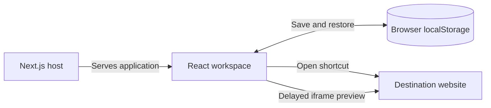

# Homelabshub

Homelabshub is a self-hosted shortcut dashboard for websites and homelab services. It provides one organized launch page for tools, media services, storage interfaces, and other web applications, without requiring a central database or a hub account.

This documentation describes general software capabilities. Personal service lists, private addresses, infrastructure details, and access credentials belong in restricted documentation.

## Features

| Feature | How it works |
| --- | --- |
| Shortcut cards | Save a website name and full HTTP or HTTPS URL; open it in a new tab |
| Categories | Create categories and display shortcuts in grouped sections; empty categories are saved too |
| Category selection | Assign a category from the dropdown when adding or editing a shortcut |
| Search and filtering | Find shortcuts by name, URL, or category, and filter the visible collection |
| Favorites | Mark frequently used shortcuts through the card menu |
| Grid and detail views | Switch between cards and a compact list; wide desktop screens show five cards per row |
| Drag arrangement | Reorder shortcuts or move them between categories by dropping onto a card in another category |
| Accessible arrangement | Use Move up and Move down in the card menu as an alternative to dragging |
| Saved preferences | Restore manual order, view mode, and sorting preferences after a refresh |
| Custom icons | Use a built-in icon or upload a PNG, JPG, or WebP image |
| Accent colors | Choose a visual accent for each shortcut |
| Hover previews | Hover over a card for two seconds to load an embedded page preview |
| Compact actions | A vertical three-dot menu contains favorite, edit, delete, and ordering actions |

The card menu appears on hover or keyboard focus and remains visible on touch devices. The layout adapts to smaller screens rather than keeping five columns at every width.

### Using the hub

1. Create categories with **Add category**, if needed.
2. Choose **Add shortcut**, enter a name and URL, and select a category.
3. Optionally choose an icon, upload an image, set an accent color, or mark the shortcut as a favorite.
4. Search, filter, or change views to find a service quickly. **Ctrl+K** or **Cmd+K** focuses search.
5. Drag shortcuts into the desired order, or use their menu's ordering actions. Changes are saved automatically in the current browser.

The hub supports up to 500 shortcuts. URL input accepts HTTP and HTTPS addresses, including hostnames and local services with explicit ports. Addresses without a scheme default to HTTP; enter `https://` explicitly for HTTPS destinations. URLs containing embedded usernames or passwords are rejected.

For long addresses, cards show a shortened site address while retaining the complete destination for navigation. Shortening the displayed text does not redact the stored URL.

### Custom icons

The editor accepts PNG, JPG, and WebP files up to 5 MB. Images are processed in the browser, scaled into a 128 × 128 canvas, and stored with the shortcut as image data. They are not uploaded to an icon server. A custom image can be removed or replaced with a built-in icon.

### Page previews

A preview opens after hovering over a card for two seconds. Leaving the card or beginning a drag closes it. The preview uses a sandboxed iframe that loads the destination directly in the browser; it does not use a third-party screenshot service.

Some websites block embedding, and browsers restrict HTTP pages inside an HTTPS hub. Use **Open page** when a preview is unavailable. A preview request still contacts the destination website; it is not a cached screenshot, an availability check, or an isolated copy of that service.

## Where the data lives

Shortcuts, categories, custom icon data, and layout preferences are saved in **browser localStorage**. There is no server-side shortcut database or cross-device synchronization.

- A refresh preserves successfully saved data in the same browser profile and site origin.
- Another device, browser profile, hostname, protocol, or port has a separate collection.
- Clearing site data or using temporary browsing can remove saved shortcuts.
- Serving the app from another address does not automatically transfer its saved collection.
- Storage limits can prevent saving, particularly when many custom icons are used. The interface reports storage errors.

The current interface does not provide import or export controls. The shared Docker server hosts the application code; it does not make each visitor's shortcut collection shared or centrally backed up.

Browser-local storage is not a password vault. Avoid putting passwords, access tokens, signed private links, or confidential query parameters in shortcut URLs.

## Technical design



The Next.js App Router serves a React and TypeScript interface. Client-side state controls categories, search, sorting, dialogs, drag interactions, and previews. After loading saved browser data, state changes are persisted to localStorage. The application validates stored shortcut structures and normalizes destination URLs.

| File | Responsibility |
| --- | --- |
| `app/page.tsx` | Main interface, editing, categories, ordering, local persistence, and previews |
| `app/globals.css` | Styling, responsive grids, detail view, menus, and previews |
| `lib/shortcuts.ts` | Shortcut types, validation, URL normalization, and ordering helpers |
| `app/layout.tsx` | Shared page layout and metadata |
| `Dockerfile` | Multi-stage build and non-root runtime |
| `compose.yaml` | Example container deployment |

The interface uses Lucide icons and custom CSS. Dependency versions are recorded in [package.json](package.json) and [package-lock.json](package-lock.json).

There is no built-in hub authentication, service health monitoring, remote service administration, or credential management. Opening a shortcut does not grant access to its destination; each linked service retains its own access controls. Restrict access to a hosted hub through your chosen deployment layer when appropriate.

## Local development

Requires Node.js 20.9 or newer and npm.

```sh
npm ci
npm run dev
```

Open [localhost:3000](http://localhost:3000/). The development and start scripts bind to all network interfaces, so consider the surrounding network when running them.

```sh
npm run typecheck
npm run build
npm start
```

Type checking validates TypeScript usage, and the production build checks that Next.js can compile the application. The application does not require a business database, service credentials, or real shortcut records to build.

## Docker deployment

With Docker Engine and Docker Compose installed:

```sh
docker compose up -d --build
docker compose ps
docker compose logs --tail=100 homelabshub
```

Review [compose.yaml](compose.yaml) for the configured port mapping before starting. Adapt networking, HTTPS routing, and access restrictions to your environment. The image builds the application and runs it as a non-root user with a health check; the example Compose file includes restart and capability restrictions. Deployment configuration should be reviewed for compatibility with the target host.

Changing or replacing the application container does not migrate browser-local data between site origins. Maintain private operational instructions separately from this README.

## Documentation privacy

Use fictional service names and example destinations in public issues, screenshots, and contributions. Do not publish personal shortcut collections, private network addresses, production endpoints, account names, access keys, or infrastructure inventories. Custom icons and preview screenshots can also reveal organization or service details; review them before sharing.

This repository documents the application, not a user's private homelab configuration.
